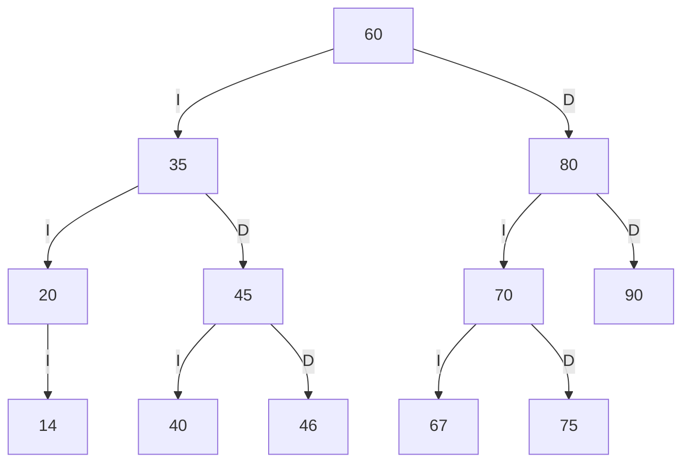
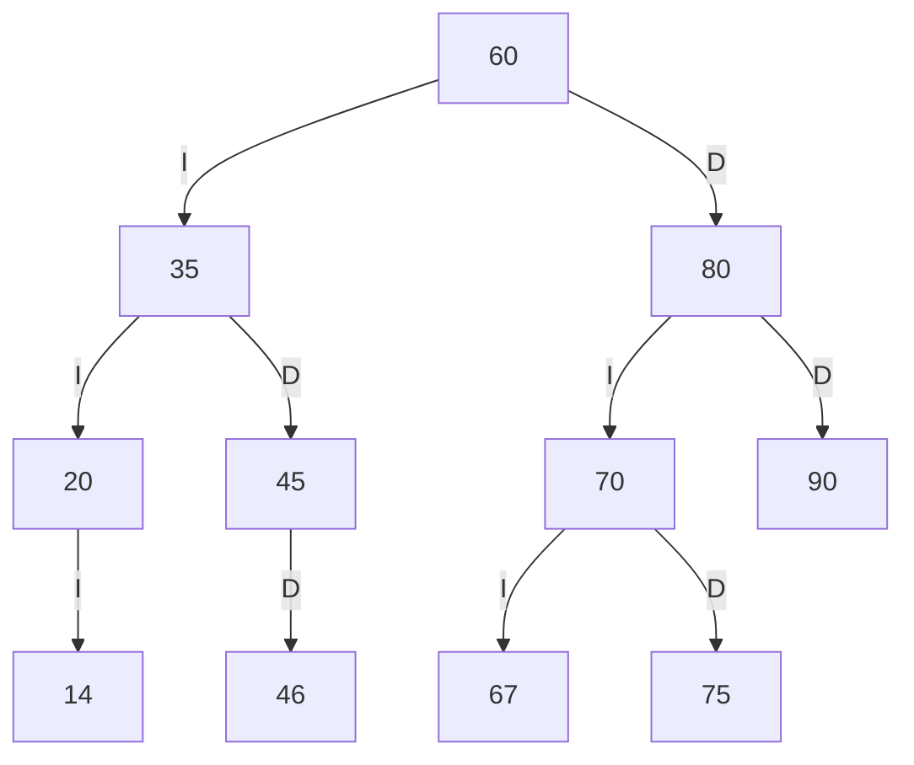
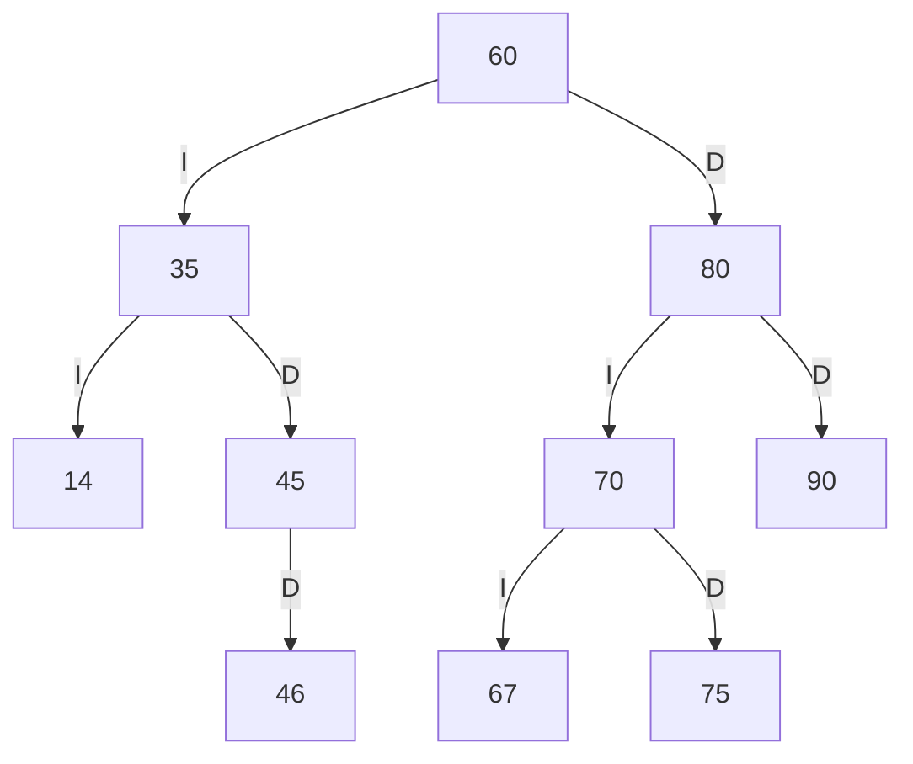
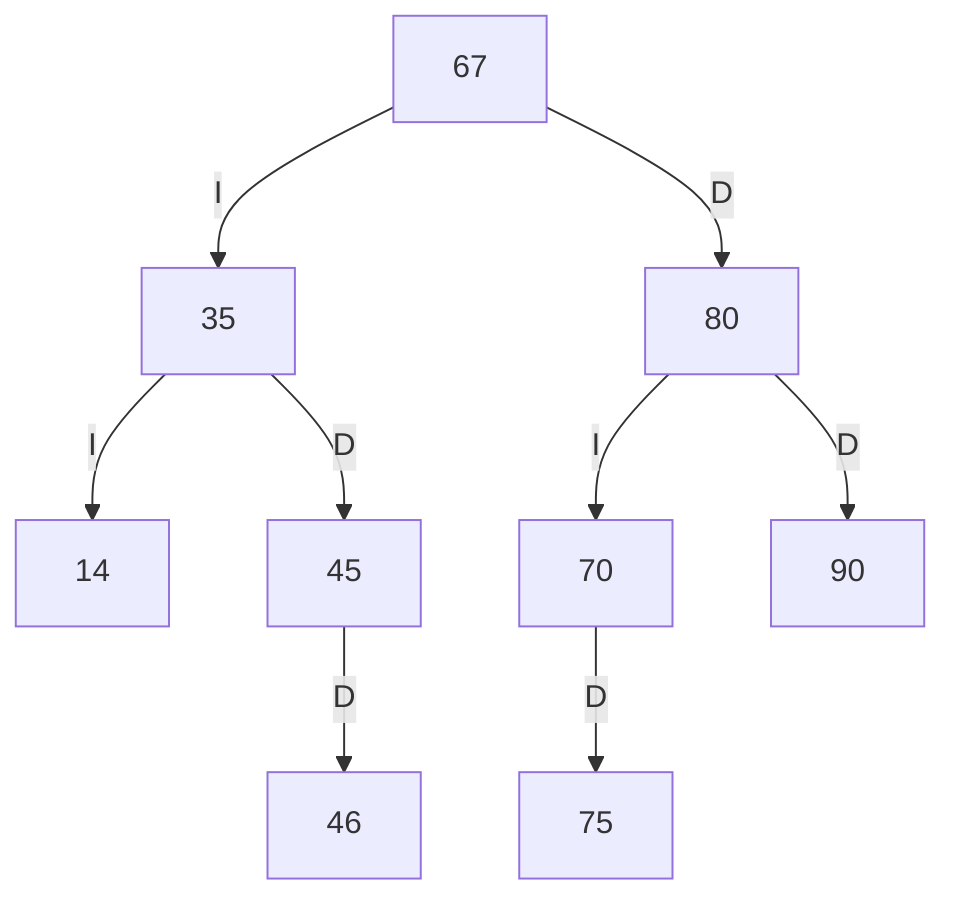

# TRAZAS - Biblioteca FISEI

> **IMPORTANTE:** este documento es una referencia generada con Java. La guía exige resolver las trazas **a mano**: reproduce y verifica personalmente los recorridos, los dibujos y los resultados.

## 1. Tres códigos personales

Cuatro dígitos usados: `1467` (a b c d).

- `ab` = 14 → 14
- `bc` = 46 → 46
- `cd` = 67 → 67

Si un código es 0, está repetido o ya está en SW-E1, se incrementa en 1 hasta encontrar uno permitido.

## 2. Inserciones y ABB resultante

Orden inicial obligatorio: `60, 35, 80, 20, 45, 70, 90, 40, 75`.

Se agregan a continuación: `14, 46, 67`.



## 3. Recorridos obtenidos con Java

- **PREORDEN:** `60 35 20 14 45 40 46 80 70 67 75 90`
- **INORDEN:** `14 20 35 40 45 46 60 67 70 75 80 90`
- **POSORDEN:** `14 20 40 46 45 35 67 75 70 90 80 60`

## 4. Traza detallada del PREORDEN

Dos espacios por nivel. Al entrar al nodo se imprime `entra X`; al visitarlo, `VISITA X`; y al encontrar un hijo vacío, `null -> regresa`.

```text
entra 60
VISITA 60
  entra 35
  VISITA 35
    entra 20
    VISITA 20
      entra 14
      VISITA 14
        null -> regresa
        null -> regresa
      null -> regresa
    entra 45
    VISITA 45
      entra 40
      VISITA 40
        null -> regresa
        null -> regresa
      entra 46
      VISITA 46
        null -> regresa
        null -> regresa
  entra 80
  VISITA 80
    entra 70
    VISITA 70
      entra 67
      VISITA 67
        null -> regresa
        null -> regresa
      entra 75
      VISITA 75
        null -> regresa
        null -> regresa
    entra 90
    VISITA 90
      null -> regresa
      null -> regresa
Secuencia PREORDEN: 60 35 20 14 45 40 46 80 70 67 75 90
```

## 5. Tres eliminaciones

Los tres borrados se aplican **en secuencia**, seleccionando en cada momento un nodo del tipo solicitado. Se conserva el ABB válido.

### 1. Eliminar 40 - hoja (sin hijos)

- `eliminar(40)`: `true`
- Preorden obtenido: `60 35 20 14 45 46 80 70 67 75 90`
- ABB válido: `true`



### 2. Eliminar 20 - nodo con un hijo

- `eliminar(20)`: `true`
- Preorden obtenido: `60 35 14 45 46 80 70 67 75 90`
- ABB válido: `true`



### 3. Eliminar 60 - nodo con dos hijos

- `eliminar(60)`: `true`
- Preorden obtenido: `67 35 14 45 46 80 70 75 90`
- ABB válido: `true`



## 6. Comprobación razonada de los cambios

Para reproducir el proceso sin depender únicamente de la salida del programa:

1. **Insertar 14:** 14 < 60, 14 < 35 y 14 < 20; se coloca como hijo izquierdo de 20.
2. **Insertar 46:** 46 < 60, 46 > 35 y 46 > 45; se coloca como hijo derecho de 45.
3. **Insertar 67:** 67 > 60, 67 < 80 y 67 < 70; se coloca como hijo izquierdo de 70.
4. **Eliminar 40 (hoja):** se quita directamente; 45 conserva su hijo derecho 46.
5. **Eliminar 20 (un hijo):** el hijo izquierdo 14 ocupa su lugar en el árbol.
6. **Eliminar 60 (dos hijos):** el sucesor inorden es 67, el menor del subárbol derecho de 60. El 67 reemplaza a 60 y desaparece de su posición anterior debajo de 70.

Los tres borrados anteriores se realizan en ese orden, sin restablecer el árbol entre operaciones.

## 7. Comparación con resolución manual

| Comprobación | Salida de Java | ¿Coincide con mi solución a mano? |
|---|---|---|
| Códigos ab, bc y cd | 14, 46, 67 | Pendiente de verificar |
| Recorridos | Apartado 3 | Pendiente de verificar |
| Traza preorden | Apartado 4 | Pendiente de verificar |
| Eliminaciones | Apartado 5 | Pendiente de verificar |

**Observación personal:** [Escribe qué comprobaste al reproducir los tres casos de eliminación y si tu dibujo a mano coincide con Java.]
